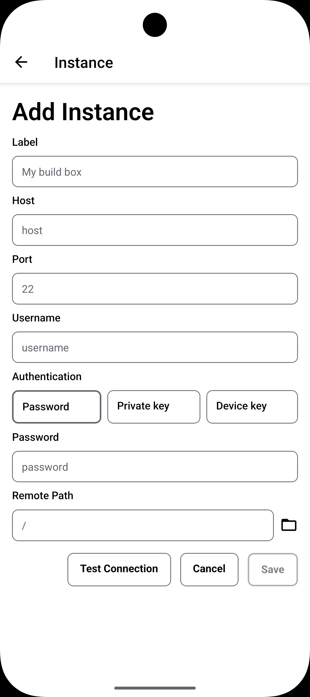
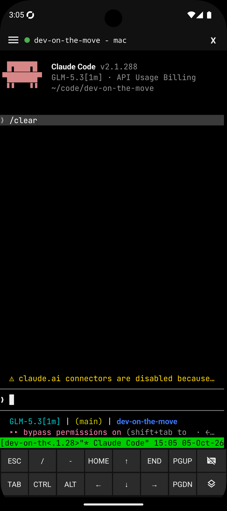
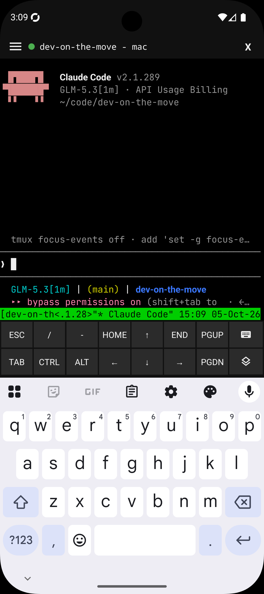
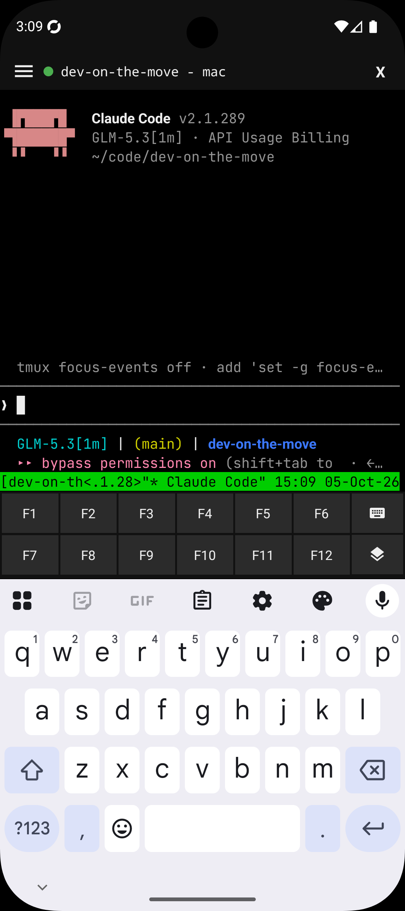
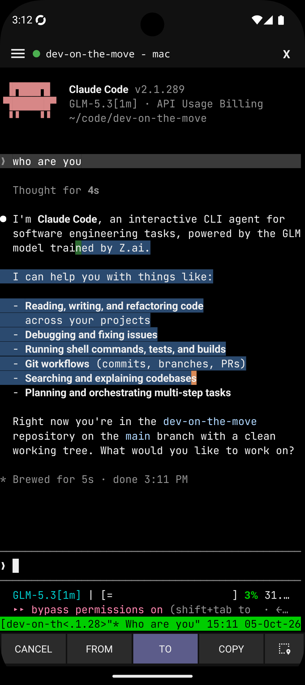
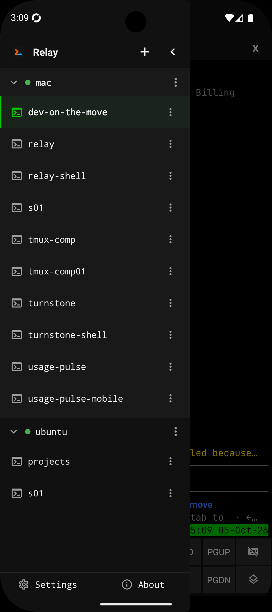

# Features

The detail behind the [README](../../README.md) feature list — settings, edge cases, and how each part of Relay behaves.

## At a glance

- **Servers** — connect to any number of SSH servers; password, private key, or device-key auth; one-shot Test Connection; clone an existing server; per-server remote working directory picked from an SSH folder browser.
- **Device SSH key** — a key generated on the device, installable onto a server straight from the server form; rename, regenerate, remove, or copy it in settings.
- **Host keys (TOFU)** — first connect shows the key's SHA256 fingerprint for accept/reject; accepted keys are kept as known_hosts-format lines.
- **Terminal** — interactive `xterm-256color` shell; extra-keys row with special, F1–F12, and select layers; hidden-keyboard input; live PTY resize; pinch-to-zoom or settings font size; landscape layout; text selection with copy; modifier lock; scrollback with tmux-aware remote scrolling.
- **tmux sessions** — a drawer to switch, create, rename, clone, and delete sessions; sessions survive disconnects and re-attach automatically; tmux install prompt when it is missing.
- **Multi-server** — stay connected to several servers at once and switch between them from the side menu.
- **Settings** — light/dark/system theming, terminal preferences, SSH key management, a biometric app lock, and an about screen.
- **Privacy** — secrets stay on the device in the OS secure store; no analytics or telemetry.

## Servers

- Manage any number of SSH servers (host, port, username).
- Authentication per server: password, private key, or the device key.
- The server form has a one-shot **Test Connection** with host-key accept/reject.
- Clone an existing server — the copy carries its credentials and gets its own tmux session prefix.
- Pick the server's remote working directory by browsing it over SSH.
- The form is keyboard-aware — it stays reachable above the keyboard.
- Credentials and known hosts are kept per profile; leaving the secret fields blank while editing a server keeps the stored values.
- Stay connected to several servers at once and switch between them from the terminal's side menu.

## Device SSH key

- Relay generates an SSH key on the device, from Settings.
- The key can be installed onto a server straight from the server form; the install is idempotent and sets the right `authorized_keys` permissions.
- Settings lets you rename, regenerate, remove, or copy the public key to the clipboard.

## Host keys (TOFU)

- Host keys are verified trust-on-first-use: on first connect you are shown the key's SHA256 fingerprint and can accept or reject it.
- Accepted keys are stored as known_hosts-format lines.

## Terminal

- Interactive `xterm-256color` PTY shell, with a 256-color palette and fallback glyphs for symbols the bundled font lacks.
- Extra keys row with three layers: ESC/TAB/CTRL/ALT/arrows and more, an F1–F12 layer, and a select layer.
- Long-press CTRL or ALT to lock the modifier for repeated chords.
- Hidden-keyboard input — terminal input goes through a hidden input field, so keystrokes reach the remote shell directly.
- Live PTY resize, with the terminal padded above the keyboard.
- Adjustable font size: pinch to zoom, or pick a size in settings.
- Dedicated landscape layout.
- Text selection with copy to clipboard, and optional selection-follows-finger.
- Around 1000 rows of local scrollback; when tmux is attached (or a program tracks the mouse), scroll gestures are forwarded to the remote side instead.
- Clean disconnect from the terminal's close action.
- Known behavior: typing `exit` in a detached terminal session ends the shell and leaves the screen on a Disconnected overlay with a Reconnect action — it should close the terminal screen and go back to the server list instead (see the planned list in the README).

## tmux sessions

- A sessions drawer to switch, create, rename, clone, and delete sessions.
- Long-running remote programs (e.g. Claude Code in tmux) survive disconnects.
- Reconnecting re-attaches automatically, to the last session you had open on that server.
- If the server has no tmux installed, Relay offers the install command for its package manager.
- Selecting an instance row detaches tmux and drops you into the server's raw shell.

## Settings

- Light/dark/system theming.
- Terminal preferences, including the font size and selection-follows-finger.
- Device SSH key management (rename, regenerate, remove, copy).
- An about screen.

## App lock

- Optional biometric app lock (Face ID / fingerprint), off by default; enable it in Settings → Security.
- When enabled, Relay asks for biometric unlock once per app launch.
- Devices without biometric hardware or enrollment bypass the lock.

## Where secrets live

Passwords, private keys, and the device key stay on the device, stored in the OS secure store (`expo-secure-store`), and are sent only to the server they belong to. Accepted host keys are stored with their server profile in local app storage. The app has no analytics or telemetry dependencies.
